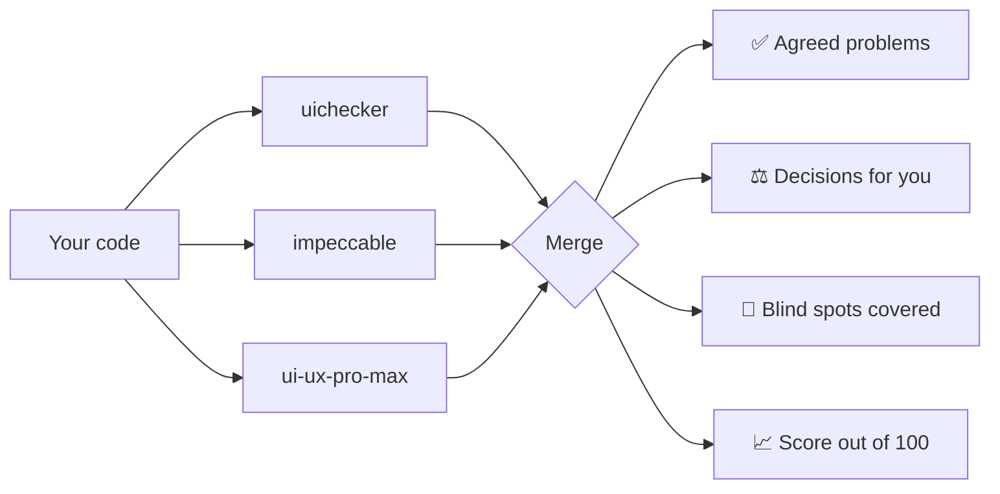

<div align="center">

# AwesomeSkills

### Claude writes your UI. These plugins make it look designed.

[](LICENSE)
[](#-quick-start)


[Quick start](#-quick-start) · [uichecker](#-uichecker) · [UltimateDesign](#-ultimatedesign) · [FAQ](#-faq) · [Русский](README.ru.md)

</div>

---

## 😬 Sound familiar?

You ask Claude for a screen. It works. And it looks like every other AI-made screen:

- a spinner, when the layout is known and a skeleton belongs there
- a form that tells you about mistakes only after you press Submit
- "Something went wrong" with no reason and no way to try again
- a modal that pops in with no motion, and focus that disappears for keyboard users
- the same purple gradient hero as everyone else

None of this is a bug, so tests won't catch it. A good designer would catch it in a minute. These two plugins give Claude that designer's eye.

---

## ✨ What's inside

<table>
<tr>
<td width="50%" valign="top">

### 🔍 uichecker
**The rulebook.**

137 UI/UX rules that Claude follows while it builds, and checks when you ask. It reviews your code the way a senior product designer would, and only for the elements you actually have.

`/uichecker:audit` · `/uichecker:review` · `/uichecker:refactor`

</td>
<td width="50%" valign="top">

### 🧠 UltimateDesign
**The panel of judges.**

Three design skills review the same UI on their own. You get one score out of 100: what they agree on, where they disagree (you choose), and what only one of them noticed.

`/ultimatedesign:audit` · `/ultimatedesign:review` · `/ultimatedesign:apply`

</td>
</tr>
</table>

---

## 🚀 Quick start

**1. Add the marketplace and install.** In Claude Code:

```text
/plugin marketplace add DenFang/AwesomeSkills
/plugin install ultimatedesign@awesome-skills
```

Prefer the terminal? Same thing:

```bash
claude plugin marketplace add DenFang/AwesomeSkills
claude plugin install ultimatedesign@awesome-skills
```

UltimateDesign brings uichecker with it. If you only want the rules, install `uichecker@awesome-skills` instead.

**2. Run your first audit.**

```text
/uichecker:audit
```

**3. Fix what matters first.**

```text
/uichecker:refactor P0
```

To get updates later, run `claude plugin marketplace update awesome-skills`.

---

## 🔍 uichecker

### It only checks what's actually there

Most checklists throw every rule at every file. uichecker first lists the elements in your code: buttons, forms, tables, dialogs, charts, navigation, animations, pricing. Then it checks only the rules for those elements. A dropdown is checked against menu, overlay and motion rules. It is never checked against table rules.

It also doesn't care about your colours. The rules are about relationships, such as "one accent, only on the main action" or "exits about 40% shorter than entrances". So they work with any brand and any stack: React, Vue, Svelte, plain CSS, Tailwind, React Native, SwiftUI and more.

### Three commands

| Command | When to use it | What you get |
|---|---|---|
| `/uichecker:audit [path]` | Once, on the whole project | A scored report, area by area, saved to `UX-AUDIT.md` |
| `/uichecker:review [branch \| PR]` | Before every merge | A verdict on your changes only |
| `/uichecker:refactor [P0 \| F-001 … \| path]` | After an audit or review | The fixes, followed by your lint, tests and build |

And while you build, there's nothing to run: the rules load on their own whenever Claude touches UI.

### What it knows

| Area | A few examples |
|---|---|
| 🎞️ Motion | durations, easing, stagger, reduced motion, shared-element transitions |
| ⏳ States | skeletons vs spinners, optimistic UI, empty, error and success states, toasts, undo, offline |
| 📝 Forms | validation timing, passwords, OTP, masks, uploads, payment fields, autosave |
| 📊 Data | tables, sorting, bulk actions, filters, search, charts, dashboards, KPI rows |
| 🖱️ Interaction | focus, keyboard, dialogs vs sheets vs drawers, menus, tooltips, drag and drop, tabs |
| 🎨 Visual system | tokens, spacing, type scale, colour roles, contrast, dark mode, radius, shadows |
| ✍️ Content | microcopy, landing structure, pricing, honest persuasion, dark patterns to refuse |
| 🤖 "Looks AI-made" | the tells that make generated UI look generic, and how to remove them |

### What a finding looks like

```markdown
### F-007 · P1 · STA-7 · Errors say what happened and offer a way out
- Where:    src/features/invoices/InvoiceList.tsx:84
- Evidence: catch (e) { setError("Something went wrong") }, with no retry
- Impact:   a user whose invoices fail to load sees no reason and has no way to try again
- Fix:      name the failure and add a Retry button that calls refetch();
            keep the loaded rows visible if this is a refresh
```

Every finding has a place in your code, a reason and a concrete fix. You won't get advice like "consider improving the hierarchy".

---

## 🧠 UltimateDesign

### Why three opinions beat one

Every design skill has blind spots. UltimateDesign runs three of them over the same code, each in its own subagent, so none of them sees the others' answers:

| Skill | Strong at |
|---|---|
| **uichecker** | product UX: states, forms, tables, navigation, accessibility |
| **[impeccable](https://github.com/pbakaus/impeccable)** by Paul Bakaus | design taste, anti-generic polish, technical audit, heuristic critique |
| **[ui-ux-pro-max](https://github.com/nextlevelbuilder/ui-ux-pro-max-skill)** by Next Level Builder | a big design database and a priority-ranked checklist |

Then it puts their answers side by side:



- ✅ **Agreed problems come first.** When three independent reviewers flag the same button, fix it.
- ⚖️ **Disagreements become your choice.** If one skill says "one sans family" and another says "add a display serif", you get `D-1: A or B`, with the pros and cons of each and a recommendation. Then run `/ultimatedesign:apply D-1=A`.
- 🔦 **Blind spots get covered.** Anything only one skill caught gets its own section, so you see what each skill adds.
- 📈 **One score you can track.** Each area is scored, and so is the whole UI out of 100, next to each skill's own score.

### Three commands

| Command | What it does |
|---|---|
| `/ultimatedesign:audit [path] [--deep]` | Reviews the whole project and writes `ULTIMATE-DESIGN.md`. `--deep` adds impeccable's heuristic critique |
| `/ultimatedesign:review [branch \| PR]` | Reviews only your changes, with a verdict |
| `/ultimatedesign:apply [recommended \| P0 \| U-001 … \| D-1=A …]` | Applies the fixes and the options you picked, then runs your checks |

### You'll also need

impeccable and ui-ux-pro-max come from their authors and are not bundled here. Install them any way you like (plugin, personal skill or project skill), and UltimateDesign will find them:

```bash
claude plugin marketplace add pbakaus/impeccable && claude plugin install impeccable@impeccable
claude plugin marketplace add nextlevelbuilder/ui-ux-pro-max-skill && claude plugin install ui-ux-pro-max@ui-ux-pro-max-skill
```

If one is missing, UltimateDesign runs with the other two and tells you what it couldn't check.

---

## 🤷 Which one do I need?

| You want… | Install |
|---|---|
| Better UI from Claude while it builds, plus quick checks | **uichecker** |
| The most thorough review, with a score and choices | **UltimateDesign** (includes uichecker) |
| Just to try it | **uichecker**, then `/uichecker:audit` |

---

## 🛡️ Safe by default

- **Audits and reviews only read.** The only file they write is the report (`UX-AUDIT.md` or `ULTIMATE-DESIGN.md`).
- **Code changes only when you ask**, through `refactor` or `apply`, and they finish by running your lint, tests and build.
- **Nothing leaves your machine.** No network calls, no hooks, no MCP servers, no telemetry.

---

## ❓ FAQ

<details>
<summary><b>Will it change my brand colours or fonts?</b></summary>

No. Every fix uses your own tokens, colours and components. The rules describe relationships, not a palette.
</details>

<details>
<summary><b>Why <code>/uichecker:review</code> and not just <code>/review</code>?</b></summary>

`/review` is already a built-in Claude Code command, so plugin commands use their full names. `/audit` and `/refactor` also work on their own as long as nothing else uses those names.
</details>

<details>
<summary><b>Does it work with my stack?</b></summary>

Yes. It reads components, templates and styles in any web or native stack, and fixes them in that stack's own idioms.
</details>

<details>
<summary><b>Can I turn off a rule I disagree with?</b></summary>

Yes. Add a `.ux-ignore.md` file to your project with the rule IDs and a reason. Matching findings are skipped, and the report says how many were hidden.
</details>

<details>
<summary><b>Where do the rules come from?</b></summary>

From more than 140 short UI/UX lessons, each turned into a precise, checkable rule. The written breakdown of every lesson is in [`research/ui-lessons/`](research/ui-lessons/INDEX.md).
</details>

---

## 📄 License

[Apache License 2.0](LICENSE). Use it, change it, and ship it in commercial work.

If you redistribute it or build on it, keep the [NOTICE](NOTICE) file and credit the original:

> Based on uichecker by DenFang (https://github.com/DenFang/AwesomeSkills)

<details>
<summary>Repository layout</summary>

```text
.claude-plugin/marketplace.json   the awesome-skills marketplace
plugins/uichecker/                rules skill and the audit, review, refactor commands
plugins/ultimatedesign/           orchestrator: passes, merge rules, report format
research/ui-lessons/              written breakdown of every lesson behind the rules
```
</details>
