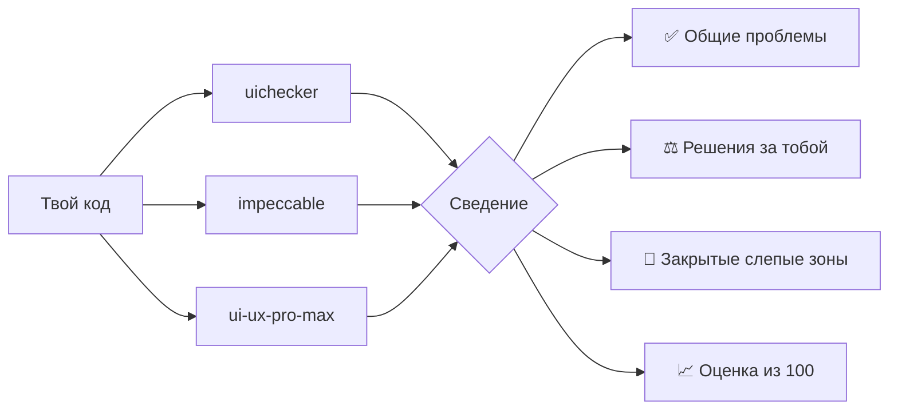

<div align="center">

# AwesomeSkills

### Claude пишет твой интерфейс. Эти плагины делают так, чтобы он выглядел задизайненным.

[](LICENSE)
[](#-быстрый-старт)


[Быстрый старт](#-быстрый-старт) · [uichecker](#-uichecker) · [UltimateDesign](#-ultimatedesign) · [Вопросы](#-вопросы) · [English](README.md)

</div>

---

## 😬 Знакомо?

Просишь Claude сделать экран. Он работает. И выглядит как любой другой экран, сделанный ИИ:

- спиннер там, где раскладка известна и нужен скелетон
- форма сообщает об ошибках только после нажатия «Отправить»
- «Что-то пошло не так», без причины и без кнопки «Повторить»
- модалка выскакивает без анимации, а фокус для клавиатуры пропадает
- тот же фиолетовый градиент в первом экране, что у всех

Это не баги, тесты такое не ловят. Хороший дизайнер заметит за минуту. Эти два плагина дают Claude его взгляд.

---

## ✨ Что внутри

<table>
<tr>
<td width="50%" valign="top">

### 🔍 uichecker
**Свод правил.**

137 правил UI/UX: Claude следует им, пока пишет код, и проверяет по ним, когда ты просишь. Смотрит на код как сильный продуктовый дизайнер, и только на те элементы, которые у тебя есть.

`/uichecker:audit` · `/uichecker:review` · `/uichecker:refactor`

</td>
<td width="50%" valign="top">

### 🧠 UltimateDesign
**Жюри из трёх экспертов.**

Три дизайн-скилла независимо смотрят один и тот же UI. Ты получаешь одну оценку из 100: в чём они согласны, где спорят (выбираешь ты) и что заметил только один из них.

`/ultimatedesign:audit` · `/ultimatedesign:review` · `/ultimatedesign:apply`

</td>
</tr>
</table>

---

## 🚀 Быстрый старт

**1. Добавь маркетплейс и установи.** В Claude Code:

```text
/plugin marketplace add DenFang/AwesomeSkills
/plugin install ultimatedesign@awesome-skills
```

Удобнее в терминале? То же самое:

```bash
claude plugin marketplace add DenFang/AwesomeSkills
claude plugin install ultimatedesign@awesome-skills
```

uichecker ставится вместе с UltimateDesign. Если нужны только правила, поставь `uichecker@awesome-skills`.

**2. Запусти первый аудит.**

```text
/uichecker:audit
```

**3. Начни с самого важного.**

```text
/uichecker:refactor P0
```

Обновления потом: `claude plugin marketplace update awesome-skills`.

---

## 🔍 uichecker

### Проверяет только то, что реально есть

Большинство чек-листов применяют все правила ко всем файлам. uichecker сначала составляет список элементов в твоём коде: кнопки, формы, таблицы, диалоги, графики, навигация, анимации, прайсинг. Потом проверяет только правила для этих элементов. Выпадающее меню проверяется по правилам меню, оверлеев и анимации, и никогда по правилам таблиц.

Цвета ему тоже не важны. Правила описывают отношения: «один акцентный цвет, только на главном действии», «исчезновение примерно на 40% короче появления». Поэтому они работают с любым брендом и любым стеком: React, Vue, Svelte, обычный CSS, Tailwind, React Native, SwiftUI и другими.

### Три команды

| Команда | Когда | Что получаешь |
|---|---|---|
| `/uichecker:audit [путь]` | Один раз на весь проект | Отчёт с оценками по областям в `UX-AUDIT.md` |
| `/uichecker:review [ветка \| PR]` | Перед каждым мержем | Вердикт только по твоим изменениям |
| `/uichecker:refactor [P0 \| F-001 … \| путь]` | После аудита или ревью | Исправления, а затем твои lint, тесты и сборка |

А пока ты пишешь код, запускать ничего не нужно: правила подключаются сами, как только Claude трогает UI.

### Что он знает

| Область | Примеры |
|---|---|
| 🎞️ Анимации | длительности, easing, stagger, reduced motion, переходы общих элементов |
| ⏳ Состояния | скелетоны или спиннеры, оптимистичный UI, пустые состояния, ошибки, успех, тосты, отмена, офлайн |
| 📝 Формы | когда валидировать, пароли, OTP, маски, загрузка файлов, платёжные поля, автосохранение |
| 📊 Данные | таблицы, сортировка, массовые действия, фильтры, поиск, графики, дашборды, KPI |
| 🖱️ Взаимодействие | фокус, клавиатура, диалог, шторка или панель, меню, тултипы, drag and drop, табы |
| 🎨 Визуальная система | токены, отступы, шкала шрифтов, роли цветов, контраст, тёмная тема, скругления, тени |
| ✍️ Тексты | микрокопирайтинг, структура лендинга, прайсинг, честное убеждение, тёмные паттерны |
| 🤖 «Выглядит как ИИ» | признаки, по которым сгенерированный UI выглядит шаблонно, и как их убрать |

### Как выглядит замечание

```markdown
### F-007 · P1 · STA-7 · Errors say what happened and offer a way out
- Where:    src/features/invoices/InvoiceList.tsx:84
- Evidence: catch (e) { setError("Something went wrong") }, with no retry
- Impact:   a user whose invoices fail to load sees no reason and has no way to try again
- Fix:      name the failure and add a Retry button that calls refetch();
            keep the loaded rows visible if this is a refresh
```

У каждого замечания есть место в коде, причина и конкретное исправление. Советов вроде «стоит улучшить иерархию» не будет.

---

## 🧠 UltimateDesign

### Почему три мнения лучше одного

У любого дизайн-скилла есть слепые зоны. UltimateDesign прогоняет один и тот же код через три скилла, каждый в отдельном субагенте, чтобы они не видели ответов друг друга:

| Скилл | Силён в |
|---|---|
| **uichecker** | продуктовый UX: состояния, формы, таблицы, навигация, доступность |
| **[impeccable](https://github.com/pbakaus/impeccable)** от Paul Bakaus | вкус, борьба с шаблонностью, технический аудит, эвристическая критика |
| **[ui-ux-pro-max](https://github.com/nextlevelbuilder/ui-ux-pro-max-skill)** от Next Level Builder | большая база дизайн-решений и чек-лист по приоритетам |

Потом он сводит ответы вместе:



- ✅ **Общие проблемы идут первыми.** Если три независимых ревьюера отметили одну кнопку, её точно надо чинить.
- ⚖️ **Споры становятся твоим выбором.** Один скилл говорит «одно семейство гротеска», другой «добавь акцидентную антикву». Ты получаешь `D-1: A или B` с плюсами и минусами каждого варианта и рекомендацией. Дальше `/ultimatedesign:apply D-1=A`.
- 🔦 **Слепые зоны закрыты.** То, что заметил только один скилл, вынесено в отдельный раздел, и видно, что добавляет каждый.
- 📈 **Одна оценка, за которой удобно следить.** Оценка по областям и общая из 100, рядом с собственной оценкой каждого скилла.

### Три команды

| Команда | Что делает |
|---|---|
| `/ultimatedesign:audit [путь] [--deep]` | Смотрит весь проект и пишет `ULTIMATE-DESIGN.md`. `--deep` добавляет эвристическую критику impeccable |
| `/ultimatedesign:review [ветка \| PR]` | Смотрит только твои изменения и выносит вердикт |
| `/ultimatedesign:apply [recommended \| P0 \| U-001 … \| D-1=A …]` | Применяет исправления и выбранные варианты, потом запускает твои проверки |

### Ещё понадобится

impeccable и ui-ux-pro-max распространяют их авторы, в этот репозиторий они не входят. Поставь их как удобно (плагином, личным или проектным скиллом), UltimateDesign их найдёт:

```bash
claude plugin marketplace add pbakaus/impeccable && claude plugin install impeccable@impeccable
claude plugin marketplace add nextlevelbuilder/ui-ux-pro-max-skill && claude plugin install ui-ux-pro-max@ui-ux-pro-max-skill
```

Если одного нет, UltimateDesign работает с двумя и говорит, что не смог проверить.

---

## 🤷 Что мне ставить?

| Хочешь… | Ставь |
|---|---|
| Чтобы Claude сразу писал UI лучше, и быстрые проверки | **uichecker** |
| Самое подробное ревью с оценкой и выбором | **UltimateDesign** (uichecker внутри) |
| Просто попробовать | **uichecker**, потом `/uichecker:audit` |

---

## 🛡️ Безопасно по умолчанию

- **Аудит и ревью только читают.** Пишут они один файл с отчётом: `UX-AUDIT.md` или `ULTIMATE-DESIGN.md`.
- **Код меняется, только когда ты просишь**: через `refactor` или `apply`, и в конце запускаются твои lint, тесты и сборка.
- **Ничего не уходит с твоей машины.** Никаких сетевых запросов, хуков, MCP-серверов и телеметрии.

---

## ❓ Вопросы

<details>
<summary><b>Он поменяет мои фирменные цвета или шрифты?</b></summary>

Нет. Все исправления используют твои токены, цвета и компоненты. Правила описывают отношения, а не палитру.
</details>

<details>
<summary><b>Почему <code>/uichecker:review</code>, а не просто <code>/review</code>?</b></summary>

`/review` уже встроена в Claude Code, поэтому у команд плагина полные имена. `/audit` и `/refactor` работают и без префикса, пока эти имена не заняты чем-то ещё.
</details>

<details>
<summary><b>Подойдёт для моего стека?</b></summary>

Да. Он читает компоненты, шаблоны и стили в любом веб- или нативном стеке и исправляет их так, как принято в этом стеке.
</details>

<details>
<summary><b>Можно отключить правило, с которым я не согласен?</b></summary>

Да. Создай в проекте файл `.ux-ignore.md` с ID правил и причиной. Такие замечания не попадут в отчёт, а в отчёте будет написано, сколько их скрыто.
</details>

<details>
<summary><b>Откуда взялись правила?</b></summary>

Из более чем 140 коротких уроков по UI/UX. Каждый урок превращён в точное проверяемое правило. Разбор каждого урока лежит в [`research/ui-lessons/`](research/ui-lessons/INDEX.md).
</details>

---

## 📄 Лицензия

[Apache License 2.0](LICENSE). Можно использовать, менять и встраивать в коммерческие проекты.

Если распространяешь или делаешь что-то на основе, сохрани файл [NOTICE](NOTICE) и укажи оригинал:

> Based on uichecker by DenFang (https://github.com/DenFang/AwesomeSkills)

<details>
<summary>Структура репозитория</summary>

```text
.claude-plugin/marketplace.json   маркетплейс awesome-skills
plugins/uichecker/                скилл с правилами и команды audit, review, refactor
plugins/ultimatedesign/           оркестратор: проходы, правила сведения, формат отчёта
research/ui-lessons/              разбор каждого урока, из которого выросли правила
```
</details>
